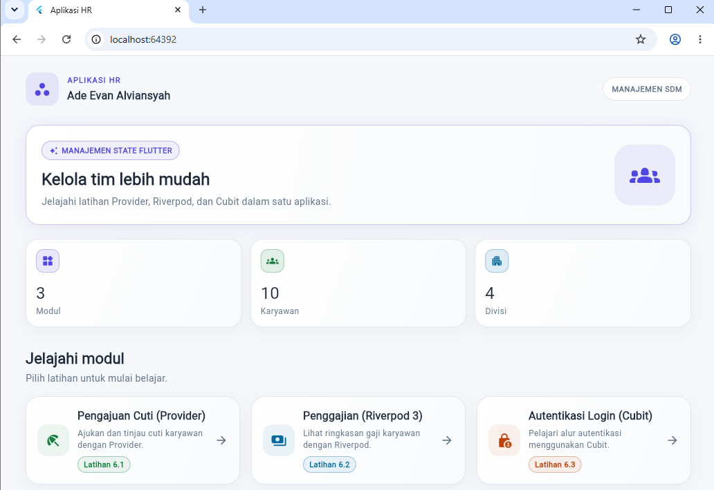
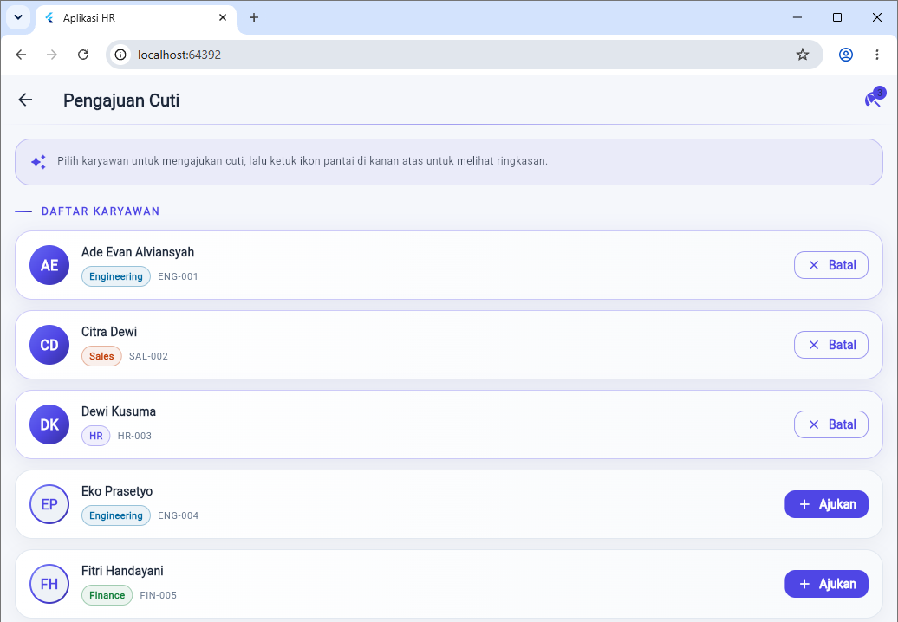
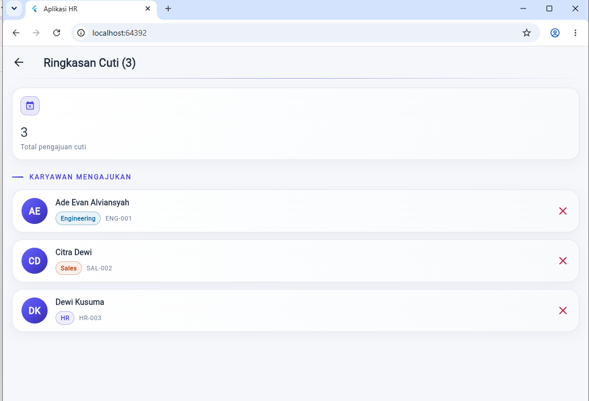
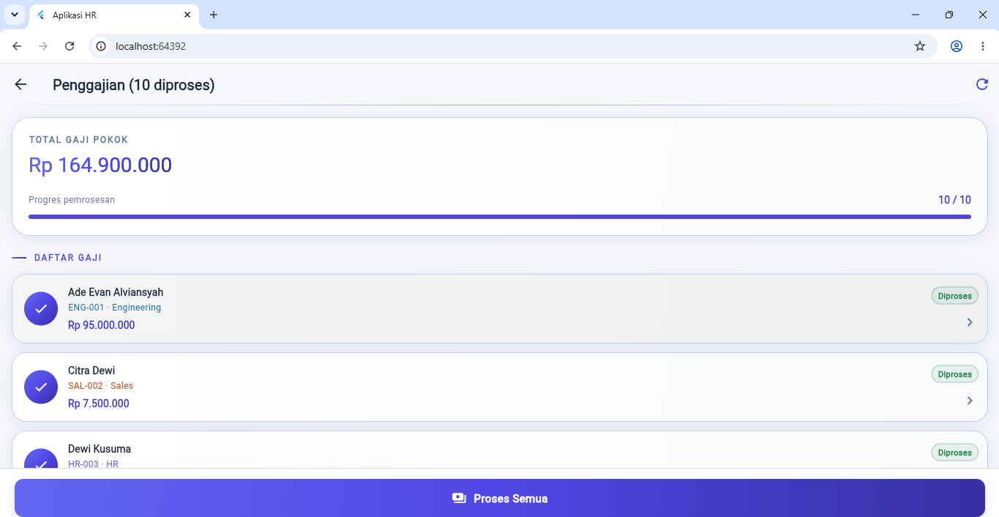
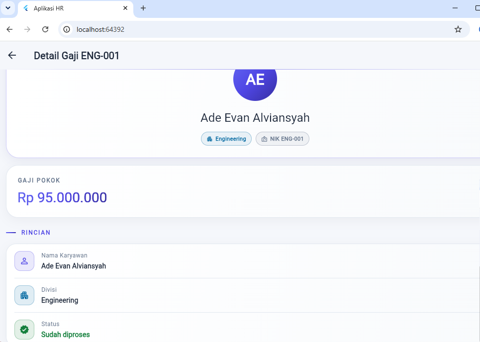
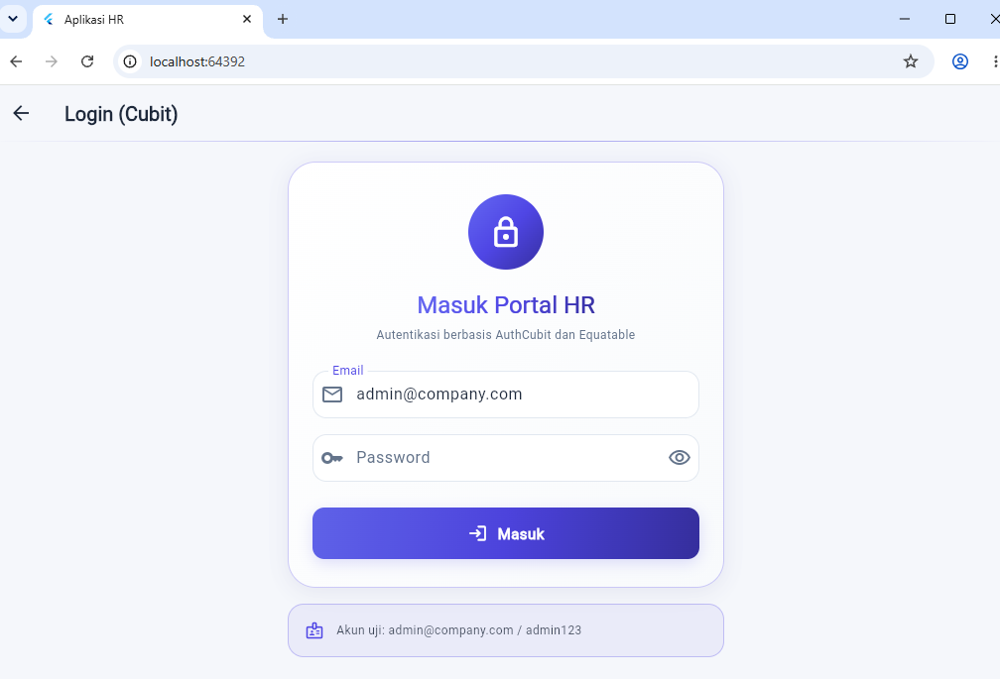

# Aplikasi HR — Praktikum BAB 6

Aplikasi Flutter sederhana untuk mempraktikkan tiga pendekatan manajemen state pada studi kasus Human Resources (HR): **Provider**, **Riverpod 3**, dan **Cubit**.

## Identitas Mahasiswa

| Keterangan | Identitas |
|---|---|
| Nama | Ade Evan Alviansyah |
| NIM | 24011130331 |
| Kelas | D3MI05AM |
| Program Studi | D3 Manajemen Informatika |

## Hasil Praktik

### 1. Pengajuan cuti — Provider

Halaman menampilkan daftar karyawan dan memungkinkan pengguna mengajukan atau membatalkan pengajuan cuti. Status pengajuan dikelola oleh `CutiNotifier` berbasis `ChangeNotifier`; badge dan halaman ringkasan mengikuti perubahan jumlah pengajuan.

### 2. Penggajian — Riverpod 3

Modul menampilkan daftar dan detail gaji karyawan, status pemuatan, serta pesan dan aksi coba lagi jika pengambilan data simulasi gagal. Tombol **Proses Semua** memperbarui status pemrosesan untuk 10 data karyawan. Data contoh pada aplikasi memiliki total gaji pokok **Rp 164.900.000**.

### 3. Autentikasi — Cubit

Alur login menggunakan `AuthCubit` dengan status loading, berhasil, dan gagal, serta mendukung logout. Autentikasi ini hanya simulasi lokal untuk latihan, bukan layanan autentikasi produksi.

## Bukti Hasil Praktik

Tangkapan layar berikut menunjukkan tampilan aplikasi dan hasil interaksi dari ketiga modul.

### Beranda dan pengajuan cuti







### Penggajian





### Autentikasi



## Teknologi

- Flutter dan Dart
- Provider (`ChangeNotifier`) untuk pengajuan cuti
- Riverpod 3 (`FutureProvider`, `NotifierProvider`) untuk penggajian
- `flutter_bloc` / Cubit dan Equatable untuk autentikasi
- Flutter Test untuk pengujian

## Menjalankan Aplikasi

Pastikan Flutter SDK tersedia, lalu jalankan perintah berikut dari direktori proyek:

```powershell
flutter pub get
flutter devices
flutter run -d chrome
```

Untuk menjalankan di Android, hidupkan emulator atau hubungkan perangkat, lalu jalankan `flutter run -d <device-id>` atau pilih perangkat melalui VS Code.

### Akun demo

- Email: `admin@company.com`
- Password: `admin123`

Akun tersebut hanya untuk mencoba simulasi login lokal.

## Pengujian dan Analisis

```powershell
flutter analyze
flutter test
```

## Struktur Proyek

```text
lib/
  main.dart
  home_page.dart
  models/
    karyawan.dart
  latihan61_provider/
  latihan62_riverpod/
  latihan63_bloc/
screenshots/
test/
android/
web/
```

Data karyawan dan gaji pada proyek ini merupakan data contoh yang didefinisikan di dalam aplikasi; proyek ini tidak menggunakan backend atau basis data produksi.
